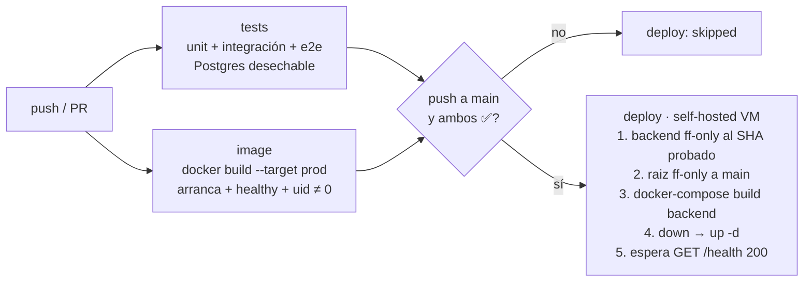

# B6 — Despliegue seguro y CI/CD (Sprint 10)

Responsable: Esteban de la Peña (el bloque estaba asignado a Ale Pérez; se intercambió) · Fecha: 2026-10-25 · Repos: `backend/` y `raiz/` (documento hermano: `raiz/docs/sprint-10/B6-despliegue-seguro-cicd.md`).

## 1. Resumen

Tests y deploy quedan en **un solo workflow** (`.github/workflows/ci.yml`). El job `deploy` tiene `needs: [tests, image]`, así que solo corre en un push a `main` si en ese mismo commit pasaron las pruebas (unitarias, integración y e2e) **y** la imagen de producción se construyó, arrancó, quedó `healthy` y no corre como root. El `Dockerfile` ahora es multi-etapa con Node 22 y `npm ci`, la imagen final lleva solo dependencias de producción, corre como `node` (uid 1000) y tiene `HEALTHCHECK`. Hay un endpoint nuevo `GET /health` (más `/health/ready`). `npm audit --omit=dev` pasa de 5 vulnerabilidades (3 altas) a **0**. Además se corrigió un fallo que venía de antes: **`npm start` no arrancaba** porque el build dejaba el entrypoint en `dist/src/main.js`. Por eso la VM corría `nest start --watch` como root en lugar de la imagen de producción.

**Criterio de aceptación: CUMPLIDO en el pipeline y en la imagen, PARCIAL en el despliegue real.** El deploy a la VM pasa por un merge a `main`, que necesita la autorización explícita del equipo. Por eso el despliegue controlado se validó con un stack equivalente local y no contra la VM ni Azure (secciones 6 y 7).

| Criterio | Estado | Evidencia |
|---|---|---|
| El pipeline impide desplegar con pruebas fallidas | ✅ | Run con test roto: `tests: failure`, `deploy: skipped`. Mismo workflow con el test arreglado: `deploy: success` (`evidencias-b6/ci-bloqueo.txt`) |
| El contenedor de producción corre sin root | ✅ local y en CI / ⏳ en la VM | `uid=1000(node)` en local, en el compose y en el job `image` de GitHub (`contenedor-prod.txt`, `compose-prod-deploy.txt`, `ci-image-job.txt`) |
| Imagen multi-etapa, Node 22, `npm ci`, solo deps de prod | ✅ | `Dockerfile`; 2.21 GB → 635 MB (`imagen-antes-despues.txt`) |
| `HEALTHCHECK` funcional | ✅ | `healthy` en local, en el compose y en CI (`contenedor-prod.txt`, `ci-image-job.txt`) |
| `GET /health` público, ligero y sin caché | ✅ | 6 tests nuevos + `curl` (`Cache-Control: no-store`, sin token, sin consultar la BD) |
| Dependencias vulnerables revisadas | ✅ | `npm-audit-antes.txt` (5) → `npm-audit-despues.txt` (0). Swagger UI, `/api-docs-json` y `/api-docs-yaml` responden 200 (`contenedor-prod.txt`, `api-prod.txt`) |
| Migraciones siguen funcionando | ✅ | 66 archivos aplicados en BD vacía; en el redeploy: `nothing to apply` (`redeploy-datos.txt`) |
| Despliegue controlado conserva los datos | ✅ en stack equivalente / ⏳ en la VM | Usuario creado antes del redeploy sigue y hace login (`redeploy-datos.txt`, `compose-prod-deploy.txt`) |
| Flujo de desarrollo intacto | ✅ | `docker-compose.local.yml` → target `dev` (`npm run dev`), con Postgres, Redis, PgBouncer y Caddy (`compose-dev.txt`) |
| Menos downtime en el deploy | ✅ medido local | 35.3 s → 8.8 s sin servicio (`compose-prod-deploy.txt`) |

## 2. Decisiones técnicas

| Decisión | Alternativas descartadas | Por qué |
|---|---|---|
| **Un workflow con `needs: [tests, image]`** y `if: push && ref == main` en `deploy` | `workflow_run` disparado al terminar "Tests" | Con `needs`, el deploy usa el mismo run y el mismo `github.sha` que se probó. `workflow_run` corre en el contexto de la rama por defecto, hay que filtrar a mano `conclusion == success` y rama, y es fácil equivocarse (por ejemplo, desplegar cuando falló o dejar de ver el check en el PR). |
| **Desplegar exactamente `github.sha`** (`git merge --ff-only "$DEPLOY_SHA"`) | `git merge --ff-only origin/main`, como antes | Si llega otro push a `main` mientras corre el pipeline, antes se habría desplegado ese commit nuevo, que todavía no había pasado las pruebas. |
| **Job `image`** que construye la imagen `prod`, la arranca contra un Postgres desechable, espera `healthy` y falla si `id -u` es 0 | Solo construir la imagen, o no probarla en CI | Los tests de Jest no ven una imagen que no arranca. El fallo de `dist/main.js` existió meses sin que nadie lo notara porque nada arrancaba la imagen `prod`. |
| **`cancel-in-progress` desactivado en `main`** y `concurrency: deploy-production` en el deploy | `cancel-in-progress: true` para todo, como antes | Si un push nuevo cancela un deploy a medias, puede quedar el stack abajo. En ramas sí se cancelan los runs obsoletos. |
| **`node:22-bookworm-slim`** en todas las etapas | `node:22-alpine`; `node:22` completo | Alpine usa musl y `bcrypt` es nativo (habría que compilarlo o confiar en prebuilds para musl). Con bookworm-slim el binario es el mismo glibc en build y runtime, y se verificó `bcrypt.hash` dentro de la imagen. La imagen completa pesa ~1 GB más sin necesidad. |
| **Árbol `/app` propiedad de root, `USER node`** | `chown -R node /app` | La app no escribe en su propio árbol (las fotos van a R2 y los logs a stdout). Si alguien compromete el proceso, no puede reescribir el código ni las migraciones. `npm` usa `/home/node` para su caché, que sí es de `node`. |
| **`HEALTHCHECK` con `node -e fetch(...)`** contra `/health` | Instalar `curl`/`wget`; usar `/health/ready` | No suma paquetes a la imagen. Se usa liveness y no readiness porque si Postgres en Azure está lento, Docker no debe marcar el contenedor como `unhealthy` (eso no se arregla reiniciando). `start-period=90s` cubre las migraciones que corren antes de que la API escuche. |
| **`/health` sin dependencias** y **`/health/ready`** con `SELECT 1` (timeout de 2 s) y ping a Redis informativo | Usar `@nestjs/terminus` | Terminus es una dependencia nueva para dos consultas. Redis no hace que la API "no esté lista" porque es una caché que falla abierta (`RedisCacheService`). |
| **`@SkipThrottle()`** en `HealthController` | Dejar el límite global de 300 req/min | Un monitor externo (B12) o el `HEALTHCHECK` no deben gastar la cuota de un cliente ni recibir 429. Hay un test que lo comprueba con `limit: 1`. |
| **`overrides` de npm** (`@nestjs/swagger → js-yaml 5.5.0`, `multer 2.5.0`) + `body-parser 2.4.0` dentro del rango de express | Subir a `@nestjs/swagger` 12 | Swagger 12 exige `@nestjs/core`/`common` 12 y TypeScript ≥ 5.5, y el repo usa Nest 11 y TS 4.9.5. Eso es migrar todo el backend, fuera del alcance de B6. Los overrides son saltos menores de las mismas líneas de versión (js-yaml 5.3→5.5, multer 2.4→2.5) y la API sigue igual (1236 unit + 14 integración + 55 e2e). Al migrar a Nest 12 se quitan. |
| **Excluir `database/` de `tsconfig.build.json`** y copiar `common-passwords.txt` como asset de Nest | Cambiar `npm start` a `node dist/src/main.js` | `database/importers/repdb/import-repdb.ts` ampliaba el `rootDir` y movía todo a `dist/src/`. Ese importador se ejecuta con `ts-node` y su propio tsconfig, nunca desde `dist/`. Con el asset, la lista de contraseñas de B4 queda junto al JS compilado y la imagen no necesita `src/`. |
| **El compose de raiz usa el target `prod` por defecto** (`BACKEND_TARGET`, sin `command:`) y `docker-compose.local.yml` usa `dev` | Mantener `npm run dev` en el compose base | Ese compose **es** lo que corre en producción (`deploy` hace `docker-compose up` en `/home/azureuser/raiz`). Con `npm run dev`, producción seguiría con root, `nest --watch` y devDependencies. |
| **El deploy también actualiza `raiz/`** (`ff-only` a `origin/main`) antes de bajar nada | Actualizar raiz a mano en la VM | La imagen `prod` con el compose viejo (`command: npm run dev`) no arranca porque no trae `@nestjs/cli`. Los dos tienen que avanzar juntos. Con `ff-only` + `set -e`, si el checkout está divergido el deploy se aborta **antes** del `down` y el contenedor viejo sigue sirviendo. |
| **`docker-compose build backend` antes del `down`** | Mantener `down && up -d --build`; blue/green con dos contenedores | El contenedor viejo sigue respondiendo mientras se compila, así que el corte es solo el reinicio. Blue/green necesita un segundo backend detrás de Caddy, nombres de contenedor distintos y trabajar alrededor de docker-compose v1 en la VM, y no compensa para un solo servidor. |

## 3. Archivos creados o modificados

| Archivo | Cambio |
|---|---|
| `.github/workflows/ci.yml` (antes `tests.yml`) | Jobs `tests` (sin cambios), `image` (nuevo) y `deploy` (movido aquí, con `needs`, SHA exacto, actualización de raiz, build antes del corte y verificación en `/health`). |
| `.github/workflows/deploy.yml` | Eliminado (su contenido está en `ci.yml` → `deploy`). |
| `Dockerfile` | Etapas `deps` → `build` → `dev` / `prod-deps` → `prod`; Node 22, `npm ci`, `USER node`, `HEALTHCHECK`. |
| `.dockerignore` | Excluye además `.github`, `reports`, `docs`, `performance`, `.env.*` y `*.tsbuildinfo`. Un `.tsbuildinfo` viejo dentro del build hace que `tsc` incremental no emita nada. |
| `tsconfig.build.json` | Excluye `database/`, así que el entrypoint vuelve a ser `dist/main.js`. |
| `nest-cli.json` | `assets: ["auth/common-passwords.txt"]` → `dist/auth/common-passwords.txt`. |
| `src/health/health.{module,controller,service}.ts` (nuevos) | `GET /health` y `GET /health/ready`. |
| `src/health/health.controller.spec.ts` (nuevo) | 6 tests: público con los guards reales, no consulta la BD, `no-store`, exento del throttle, 200/503 según Postgres, Redis caído no afecta, timeout de 2 s. |
| `src/cache/redis-cache.service.ts` (+ spec) | `ping(): 'up' \| 'down' \| 'disabled'`, que nunca lanza error. |
| `src/app.module.ts`, `src/main.ts` | Registra `HealthModule` y el tag Swagger `Health`. |
| `package.json`, `package-lock.json` | `overrides` (js-yaml 5.5.0 en swagger, multer 2.5.0); `body-parser` 2.3.0 → 2.4.0 y sus transitivas `iconv-lite` y `qs`; `argparse` 3 (dependencia de js-yaml 5.5). |
| `performance/README.md` | El comando de arranque usa `dist/main.js`. |
| `docs/sprint-10/B6-despliegue-seguro-cicd.md`, `docs/sprint-10/evidencias-b6/` | Este documento y su evidencia. |

## 4. Configuración, variables e infraestructura

- **Sin cambios de BD** y sin migraciones nuevas.
- **Variables nuevas:** ninguna obligatoria. `PORT` (por defecto 3000) ya existía. `BACKEND_TARGET` (en raiz, por defecto `prod`) permite levantar el target `dev` contra Azure.
- **Imagen:** `NODE_ENV=production` (no hay código que lo lea; lo leen express y las librerías) y `NPM_CONFIG_UPDATE_NOTIFIER=false`.
- **Manual en la VM (una vez, antes del primer deploy con B6):** `/home/azureuser/raiz` tiene que estar en `main`, limpio y poder avanzar con fast-forward (`git -C /home/azureuser/raiz status`). Si no, el deploy se aborta sin bajar nada, que es lo seguro.
- **Orden de merge a `main`** (necesita confirmación explícita del equipo): primero `raiz` (development → main) y después `backend`. El deploy del backend ya trae el raiz nuevo, pero tenerlo en `main` antes evita que el compose viejo quede en la VM.
- **Configuración manual en GitHub** (la cuenta que hizo B6 no es admin del repo: `permissions.admin = false`; `GET /branches/main/protection` → 404, es decir, sin protección). La tiene que hacer alguien con rol admin:
  1. *Settings → Branches → Add branch ruleset* (o *classic protection rule*) para `main`:
     - **Require a pull request before merging** (sin pushes directos).
     - **Require status checks to pass**, marcando `tests` e `image` (aparecen en la lista después de que corren una vez; en los PR se ven como `CI / tests` y `CI / image`).
     - **Require branches to be up to date before merging**.
     - **Block force pushes** y **Restrict deletions**.
  2. Lo mismo para `development`, con los checks `tests` e `image`.
  3. *Settings → Environments → New environment `production`* (opcional, recomendado): después se puede agregar `environment: production` al job `deploy` con *required reviewers* para que cada deploy necesite una aprobación. No lo activé porque sin el environment creado el job fallaría.

  Sin la protección de rama, el pipeline ya **impide desplegar** código con pruebas fallidas, porque `deploy` depende de `tests` e `image`. Lo que no impide es que alguien *haga merge* a `main` de un commit rojo. Ese commit no llegaría al servidor, pero `main` quedaría rojo.

## 5. Cómo se probó

| Prueba | Comando | Resultado |
|---|---|---|
| Unitarias | `env -u B2_TEST_DB_URL npx jest --ci` (Postgres 16 desechable) | 67 suites, **1222 pasan**, 14 omitidas, 0 fallan |
| Integración con BD | `npx jest --ci integration` | **14/14** |
| e2e de la API | `npm run test:e2e -- --ci` (worktree limpio, igual que CI) | **55/55** |
| CI real (rama B6) | push a `feature/sprint10-b6-cicd` | `tests` ✅, `image` ✅, `deploy` omitido (no es main) |
| Bloqueo del deploy | rama desechable con test roto y después arreglado | `deploy: skipped` → `deploy: success` |
| Tests nuevos | `npx jest src/health src/cache` | 6 de health + 2 de `ping()` |
| Mutación | quitar `@SkipThrottle()` y volver a correr | 3 tests fallan (con eso se comprueba que la prueba detecta la regresión) |
| Build | `npm run build` | `dist/main.js` y `dist/auth/common-passwords.txt` |
| Lint del workflow | `actionlint 1.7.7` | Sin errores. Se ignoran la etiqueta propia del runner y SC2016, que es intencional (comillas simples de `flock -c`) |
| Lint del código nuevo | `npx eslint src/health` | 0 errores. Hay 8 warnings del mismo tipo que los demás specs con supertest |
| Imagen | `docker build --target prod` + `docker run` contra Postgres y Redis | `healthy`, `uid=1000(node)`, `/health` 200, `/health/ready` 200/503 |
| Flujos de la API en la imagen | registro, contraseña común, login, `/users/me` con y sin token | 200 / 400 / 200 / 200 / 401 (`api-prod.txt`) |
| Swagger | `ENABLE_SWAGGER=true`: `/api-docs/`, `/api-docs-json`, `/api-docs-yaml` | 200; 109 rutas y 77 schemas; YAML generado con js-yaml 5.5.0 |
| Redeploy y datos | `docker rm -f` + `docker run` con un sondeo cada 0.2 s | 1.3 s de corte; usuario y sesiones intactos; migraciones `nothing to apply` |
| Stack de raiz (dev) | `docker compose -f docker-compose.yml -f docker-compose.local.yml up -d --build` | 5 servicios arriba, `npm run dev` como `node`, `/health/ready` ok, Caddy → `/health` 200 |
| Stack de raiz (prod) y downtime | mismo compose con target `prod`, dos redeploys con `build --no-cache` | 35.3 s (método anterior) vs 8.8 s (B6), datos intactos, `healthy` |

`npm run lint` en todo el repo sigue con los mismos errores que ya existían (327). CI no corre lint y B6 no lo cambia.

## 6. Evidencia

Todo en `docs/sprint-10/evidencias-b6/`:

- `ci-bloqueo.txt`: los tres runs de GitHub (bloqueado, desbloqueado y rama real) con sus URL.
- `ci-image-job.txt`: salida del job `image` en GitHub (`HEALTHCHECK: healthy`, `id`, tamaño).
- `imagen-antes-despues.txt`: tamaño, usuario y `HEALTHCHECK` antes y después, y el fallo de `dist/main.js`.
- `contenedor-prod.txt`: `docker exec … id`, procesos, `docker inspect …State.Health`, `/health`, `/health/ready`, Swagger y migraciones.
- `api-prod.txt`: registro, login, guard y lista de contraseñas comunes dentro de la imagen.
- `health-ready-fallas.txt`: Postgres caído → 503 en 0.16 s y `/health` sigue en 200; Redis caído → 200.
- `redeploy-datos.txt` y `compose-prod-deploy.txt`: datos antes y después, y downtime medido.
- `compose-dev.txt`: flujo `dev:local` completo.
- `npm-audit-antes.txt` / `npm-audit-despues.txt`.
- `tests-local.txt`: resultados de la suite y una nota sobre el `.env` local.

### Diagrama del pipeline



### Salida de `id` y del `HEALTHCHECK` (contenedor de producción)

```text
$ docker exec b6-api id
uid=1000(node) gid=1000(node) groups=1000(node)

$ docker inspect --format '{{json .State.Health}}' b6-api
{"Status": "healthy", "FailingStreak": 0, "Log": [{"ExitCode": 0, ...}]}

# job `image` en GitHub Actions (run 40173385418)
HEALTHCHECK: healthy
uid=1000(node) gid=1000(node) groups=1000(node)
```

### Tamaño de la imagen

| | Antes (`node:20`, 1 etapa) | Después (target `prod`) |
|---|---|---|
| En disco (`docker image ls`) | 2.21 GB | **635 MB** (−71 %) |
| Comprimida | 509.6 MB | **115.2 MB** (−77 %) |
| Usuario | root | `node` (uid 1000) |
| `HEALTHCHECK` | no | `GET /health` cada 30 s |

### Prueba del bloqueo

| Run | Commit | `tests` | `image` | `deploy` |
|---|---|---|---|---|
| [40173562364](https://github.com/mariale-sierra/backend/actions/runs/40173562364) | test roto | ❌ failure | ✅ | ⏭️ **skipped** |
| [40173705304](https://github.com/mariale-sierra/backend/actions/runs/40173705304) | test arreglado | ✅ | ✅ | ✅ success (simulado) |

## 7. Pendientes, riesgos y dependencias

- **Despliegue real en la VM (pendiente, necesita autorización):** se hace con el merge `development → main` de raiz y de backend (sección 4). Hay que verificar en la VM, en el primer run, la salida de `docker exec havit-backend id` y el `healthy`, que el job `deploy` ya imprime. Los datos viven en Azure Postgres y no en el contenedor, así que el reemplazo del contenedor no los toca (igual que en la prueba local).
- **El runner de la VM tiene docker-compose v1.** Los tiempos de downtime se midieron con compose v2 en macOS. La diferencia (el build sale del corte) se mantiene, pero los segundos exactos en la VM pueden variar.
- **El downtime no es cero:** quedan ~9 s de `down`/`up` (Caddy, PgBouncer y Redis también se reinician por el workaround de `KeyError ContainerConfig` de compose v1). Para llegar a cero haría falta blue/green detrás de Caddy o compose v2 en la VM (que permitiría recrear solo `backend`). Queda propuesto, no implementado.
- **Protección de rama y environment `production`:** son configuración manual de un admin (sección 4).
- **`overrides` de npm:** son temporales hasta migrar a Nest 12 / Swagger 12 (y TS ≥ 5.5). En ese momento hay que quitarlos y volver a correr `npm audit`.
- **`npm audit` completo (con dev):** 14 hallazgos (9 low, 4 moderate, 1 high), todos en devDependencies que no entran a la imagen `prod`: la cadena de `jest` 27 (`jsdom`, `http-proxy-agent`, `@tootallnate/once` y el `js-yaml` 3.14 de istanbul), `autocannon` (benchmarks, por `hyperid`/`uuid`) y `fast-uri`. Quedan fuera del alcance de B6 ("dependencias del backend en producción"). Subir jest 27 → 29+ es una tarea propia porque cambia la config de ts-jest.
- **B3:** el compose y la VM son los mismos. Se respetaron `caddy`, `BACKEND_BIND_ADDR`, `TRUST_PROXY` y `DB_SSL_CA_PATH` (la imagen copia `certs/`). El health check del deploy ahora usa `http://localhost:3000/health`, que sigue funcionando con `BACKEND_BIND_ADDR=127.0.0.1`.
- **B12:** puede usar `GET /health` (liveness) para UptimeRobot o Better Stack, y `GET /health/ready` si quiere alertar cuando Postgres no responde. Los dos son públicos, no gastan cuota del rate limit y no se cachean.
- **Riesgo nuevo:** producción pasa de `nest start --watch` a `node dist/main.js`. Es el modo correcto, pero es un cambio real de cómo arranca la VM. Lo cubren el job `image` (que arranca justo esa imagen) y la verificación en `/health` del deploy.

## 8. Cómo revertir

- **Todo B6:** `git revert` de los commits de B6 en backend y raiz, y merge del revert a `development` y después a `main`. Al volver, `tests.yml` y `deploy.yml` reaparecen.
- **Solo la imagen en la VM** (por ejemplo, si `prod` falla al arrancar): en `/home/azureuser/raiz`, `docker-compose rm -sf backend && BACKEND_TARGET=dev docker-compose up -d --build backend` (primero `rm`: compose v1 truena si recrea el contenedor en el lugar) vuelve a `npm run dev` con la misma imagen multi-etapa, mientras se investiga.
- **Solo las dependencias:** quitar `overrides` de `package.json`, `npm install` y commit del lockfile.
- **Solo el bloqueo del deploy:** no se recomienda. Si alguna vez hiciera falta desplegar con CI caído, se puede correr a mano en la VM el mismo bloque de comandos del job `deploy`.
